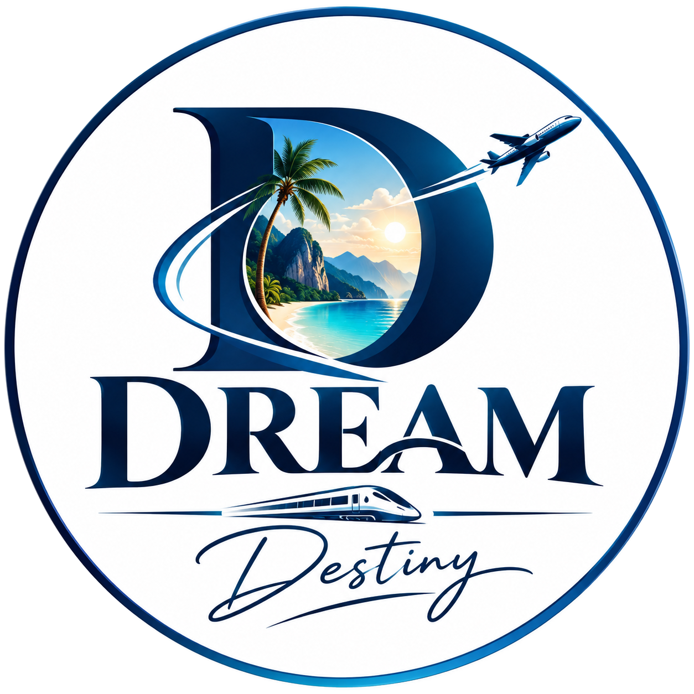
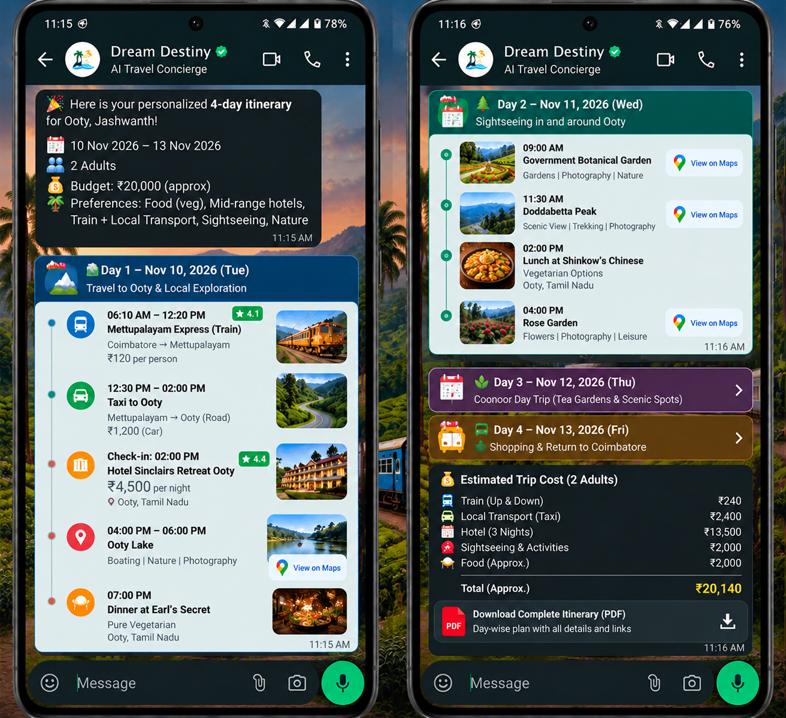
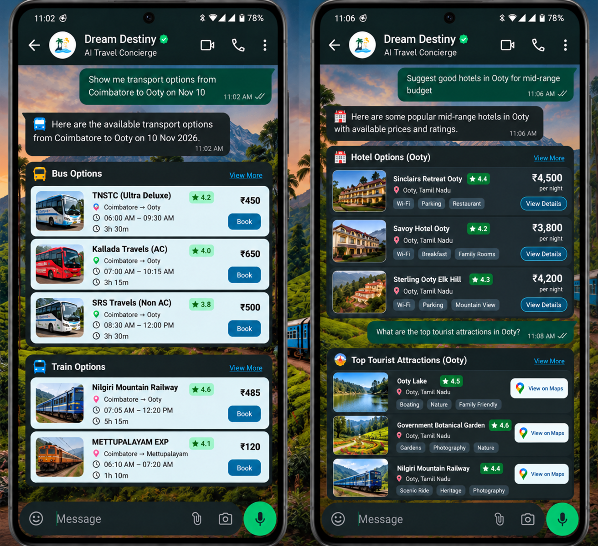
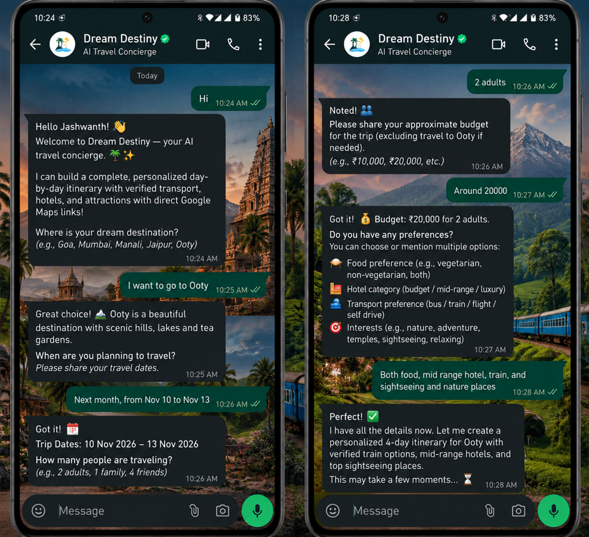
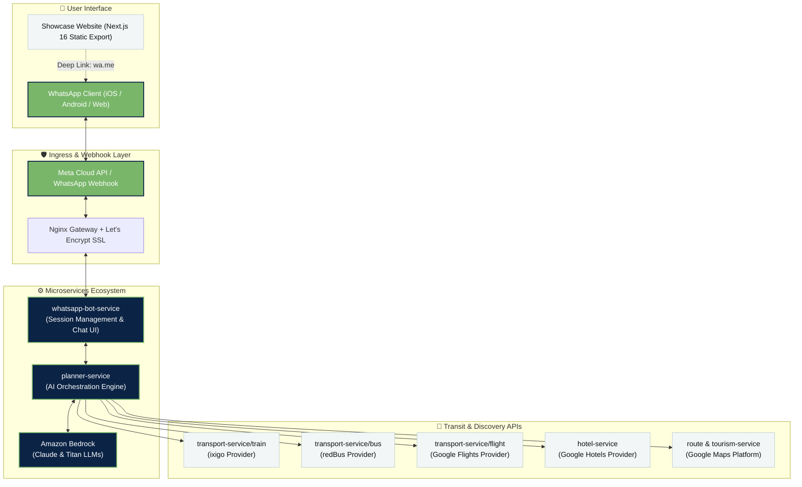

<div align="center">

<!-- PROJECT LOGO BANNER -->
<p align="center">
  <a href="https://github.com/jashwanth-cse/DreamDestiny">
    
  </a>
</p>

# 🧭 Dream Destiny
### *Your AI Travel Companion — Living Directly Inside WhatsApp*

**Plan personalized multi-day journeys, compare trains, buses, and flights, and discover curated stays in seconds—all through a single chat.**

<p align="center">
  <a href="#-quick-start"><strong>Get Started »</strong></a> ·
  <a href="#-how-it-works"><strong>How It Works »</strong></a> ·
  <a href="#-system-architecture"><strong>System Architecture »</strong></a> ·
  <a href="dream-destiny-showcase/"><strong>Showcase Website »</strong></a>
</p>

<!-- BADGES -->
<p align="center">
  
  
  
  
  
  
  
</p>

<!-- VALUE PROPOSITION HIGHLIGHT -->
> ### 💡 **"No app installation. No separate signup. Just WhatsApp."**
> Unlike conventional booking engines and multi-tab browser planners, **Dream Destiny** eliminates interface fatigue. You message a friend; Dream Destiny returns an end-to-end, multi-modal itinerary backed by live Indian travel intelligence.

---

</div>

<br />

## 🌟 Why Dream Destiny?

Traditional travel planning is broken across 5+ disparate tabs: checking train availability on IRCTC/ixigo, searching bus routes on redBus, comparing flights on Google Flights, researching hotels, and manually plotting attractions on Google Maps. 

**Dream Destiny unifies the entire stack into one conversational assistant:**

```text
 💬 "Planning a 3-day weekend from Mumbai to Udaipur with my partner. Want scenic spots, lakes, and good food."
                            │
                            ▼
 ⚡ Bedrock AI synthesizes logistics + preferences in real time
                            │
 ├── 🚆 Rail:     BDTS UDZ SF EXP (Overnight train timings & berth classes via ixigo)
 ├── 🏨 Stays:    Lake Pichola heritage havelis & price indicators (via Google Hotels)
 ├── 🗺️ Explore:  Day-by-day walking circuits around City Palace & Ambrai (via Google Maps)
 └── 📋 Summary:  Clean, interactive WhatsApp card blueprint sent in under 5 seconds!
```

---

## 📱 Live WhatsApp Experience & Interface Walkthrough

<div align="center">

<p align="center">
  <em>High-resolution captures of the live conversational flow inside WhatsApp (1312 × 1199 px, 1.09:1 aspect ratio)</em>
</p>

<table>
  <thead>
    <tr style="background: #F2F6F6;">
      <th align="center" width="33.33%">
        <h3>1️⃣ Greeting & Onboarding</h3>
      </th>
      <th align="center" width="33.33%">
        <h3>2️⃣ Transit & Attractions</h3>
      </th>
      <th align="center" width="33.33%">
        <h3>3️⃣ Day-Wise Itinerary</h3>
      </th>
    </tr>
  </thead>
  <tbody>
    <tr>
      <td align="center" valign="top">
        <a href="./img1.png" target="_blank" rel="noopener noreferrer">
          
        </a>
      </td>
      <td align="center" valign="top">
        <a href="./img2.png" target="_blank" rel="noopener noreferrer">
          
        </a>
      </td>
      <td align="center" valign="top">
        <a href="./img3.png" target="_blank" rel="noopener noreferrer">
          
        </a>
      </td>
    </tr>
    <tr>
      <td align="left" valign="top">
        <ul>
          <li><strong>Zero Friction:</strong> Chat begins immediately in WhatsApp; no separate app or account creation.</li>
          <li><strong>Intent Extraction:</strong> Understands natural conversational trip ideas, dates, and budgets.</li>
          <li><strong>Quick-Reply Chips:</strong> Contextual suggestions guide user inputs without typing friction.</li>
        </ul>
      </td>
      <td align="left" valign="top">
        <ul>
          <li><strong>Multi-Modal Transit:</strong> Indian Railways schedules via <em>ixigo</em>, intercity buses via <em>redBus</em>, & flights.</li>
          <li><strong>Curated Spots:</strong> Key cultural landmarks and viewpoints mapped via <em>Google Maps</em>.</li>
          <li><strong>Live Timings:</strong> Direct station/stop information and departure windows.</li>
        </ul>
      </td>
      <td align="left" valign="top">
        <ul>
          <li><strong>Generative Blueprint:</strong> Hour-by-hour schedules structured by <em>Amazon Bedrock</em>.</li>
          <li><strong>Stay Recommendations:</strong> Verified lodging and price indicators via <em>Google Hotels</em>.</li>
          <li><strong>Conversational Tweaks:</strong> Simply reply <em>"More relaxed"</em> or <em>"Budget stays"</em> to re-plan.</li>
        </ul>
      </td>
    </tr>
  </tbody>
</table>

<p align="center">
  <sub>💡 <em>Tip: Click any screenshot to view the full 1312×1199 high-resolution capture.</em></sub>
</p>

</div>

---

## ✨ Core Features

| Capability | Integration Provider | Description |
|:---|:---:|:---|
| **🧠 Generative Itinerary Synthesis** |  | Foundation models turn unstructured conversation into structured, timed itineraries. |
| **🚆 Real-time Rail Discovery** |  | Schedules, train numbers, running status, and berth class options across Indian Railways. |
| **🚌 Intercity Coach Discovery** |  | Intercity bus routes, AC Sleeper/Seater availability, pickup hubs, and operator ratings. |
| **✈️ Flight Fare Intelligence** |  | Non-stop & connecting flight timetables and price comparisons for domestic routes. |
| **🏨 Verified Stay Suggestions** |  | Curated accommodations filtered by proximity to planned attractions and user budget. |
| **🗺️ Geospatial Route Context** |  | Distance calculations, transit hours, and realistic walking buffers between landmarks. |
| **🌐 Static Marketing Showcase** |  | High-performance landing page adhering to the TripForge soft-minimal palette. |

---

## 🏗️ System Architecture

Dream Destiny is architected as an asynchronous, containerized microservices ecosystem designed for high concurrency and sub-second WhatsApp response latencies:



---

## 📂 Repository Structure

```text
Dream Destiny v2.0/
├── whatsapp-bot-service/     # WhatsApp Webhook ingress, session state & message templating
├── planner-service/          # Generative trip blueprint engine powered by Amazon Bedrock
├── transport-service/
│   ├── train/                # Indian Railways integration via ixigo
│   ├── bus/                  # Intercity bus network discovery via redBus
│   └── flight/               # Airfare & schedule discovery via Google Flights
├── hotel-service/            # Accommodation discovery via Google Hotels
├── route-service/            # Routing, distance metrics & waypoint sequencing
├── tourism-service/          # Attractions, POIs & destination metadata via Google Maps
├── shared/                   # Shared Pydantic models, logging & circuit breakers
├── dream-destiny-showcase/   # Next.js 16 static marketing site (pnpm, TypeScript, Tailwind)
├── docker-compose.yml        # Development orchestration
├── docker-compose.prod.yml   # Production container stack
└── nginx.conf                # Reverse proxy, SSL termination & rate limiting
```

---

## 🚀 Quick Start

### 1. Prerequisites
- [Docker](https://www.docker.com/) & [Docker Compose](https://docs.docker.com/compose/)
- [Python 3.11+](https://www.python.org/)
- [Node.js 22+](https://nodejs.org/) & [pnpm 11+](https://pnpm.io/)
- AWS Account with **Amazon Bedrock** model access enabled

### 2. Environment Configuration
Clone the repository and copy the environment template:
```bash
git clone https://github.com/your-username/dream-destiny.git
cd dream-destiny
cp .env.example .env
```

Configure your API credentials in `.env`:
```dotenv
# --- WHATSAPP CLOUD API ---
WHATSAPP_TOKEN=your_meta_access_token
WHATSAPP_PHONE_NUMBER_ID=your_phone_id
WHATSAPP_VERIFY_TOKEN=your_secure_verify_token

# --- AWS BEDROCK ---
AWS_REGION=us-east-1
AWS_ACCESS_KEY_ID=your_aws_key
AWS_SECRET_ACCESS_KEY=your_aws_secret
BEDROCK_MODEL_ID=anthropic.claude-3-haiku-20240307-v1:0

# --- PROVIDER APIs ---
SERPAPI_API_KEY=your_serpapi_key  # Google Flights / Hotels
GOOGLE_MAPS_API_KEY=your_google_maps_key
```

### 3. Launch Services with Docker Compose
```bash
docker compose up --build -d
```
All microservices will spin up with health checks:
- WhatsApp Bot Gateway: `http://localhost:8000`
- Planner Engine: `http://localhost:8001`
- Transport Service: `http://localhost:8002`
- Hotel Service: `http://localhost:8003`

### 4. Run the Showcase Landing Page
```bash
cd dream-destiny-showcase
pnpm install
pnpm dev

# Static production build & serve:
pnpm build
pnpm serve
```
Open **`http://localhost:3000`** to view the live showcase!

---

## 🎨 Design System & Color Palette

Dream Destiny pairs a modern travel-editorial aesthetic with WhatsApp conversational simplicity, adapted from the [TripForge Dribbble concept](https://dribbble.com/shots/27319870-TripForge-AI-for-Trip-Planner-Detail-Feature-Page):

| Swatch | Color Name | Hex Code | Primary Purpose |
|:---:|:---|:---:|:---|
|  | **Brand Navy** | `#0B2345` | Primary brand anchor, cards, trust badges |
|  | **Botanic Green** | `#79B66A` | WhatsApp CTAs, active status, confirm badges |
|  | **Soft Sage** | `#B7D7AD` | Tinted tags, metric chips, eco badges |
|  | **Stone Canvas** | `#F2F6F6` | Eye-friendly background, non-glare surface |
|  | **Deep Ink** | `#0D0F10` | High-contrast typography, hardware bezels |

---

## 🔒 Security & Data Integrity

- **No Public DB Writes:** The showcase website is 100% static; user reviews query a read-only Firestore collection (`published == true`).
- **Encrypted Messaging:** Conversations adhere to WhatsApp Cloud API end-to-end security standards.
- **Zero Fabrication:** The assistant displays verified transport schedules and live availability data without fabricating booking promises.

---

## ⚖️ Provider Trademarks & Attribution

- **Google Maps, Google Flights, Google Hotels** are registered trademarks of *Google LLC*. Geospatial displays preserve official Google Maps Platform branding and attribution.
- **Amazon Bedrock and AWS** are registered trademarks of *Amazon.com, Inc.* or its affiliates.
- **ixigo** is a registered trademark of *Le Travenues Technology Limited*.
- **redBus** is a registered trademark of *ibibo Group / MakeMyTrip Limited*.
- *Inclusion of provider names or marks does not imply formal endorsement or sponsorship.*

---

## 🤝 Contributing

Contributions are welcome! Please follow these steps:
1. Fork the Project
2. Create your Feature Branch (`git checkout -b feature/AmazingFeature`)
3. Commit your Changes (`git commit -m 'feat: Add AmazingFeature'`)
4. Push to the Branch (`git push origin feature/AmazingFeature`)
5. Open a Pull Request

---

<div align="center">

Made with 💚 for travelers across India.  
**Dream Destiny — Your Travel Companion.**

⭐ **Star us on GitHub** if you believe travel planning should be as simple as sending a message!

</div>
