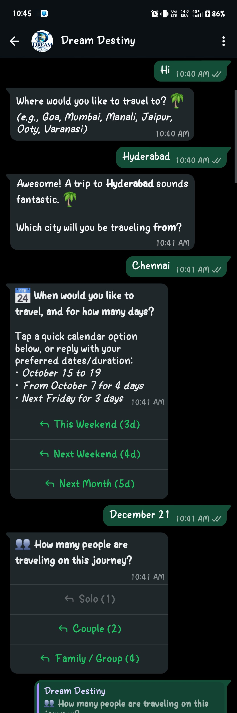
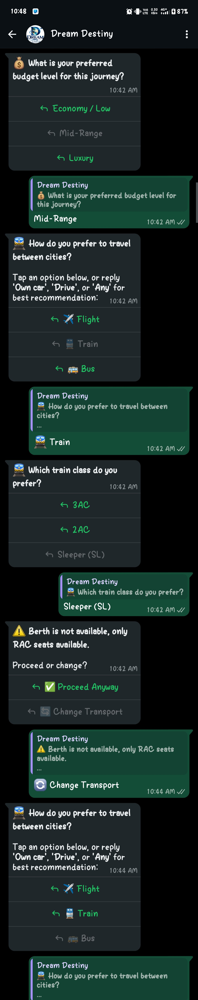
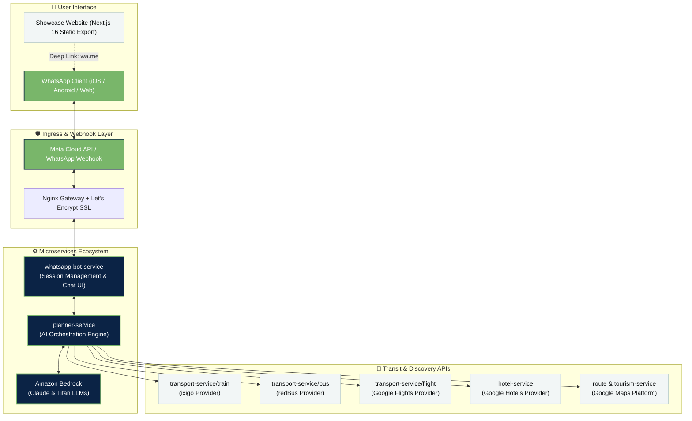

<div align="center">

<!-- PROJECT LOGO BANNER -->
<p align="center">
  <a href="https://github.com/jashwanth-cse/DreamDestiny">
    
  </a>
</p>

# 🧭 Dream Destiny
### *Your AI Travel Companion — Living Directly Inside WhatsApp*

**Plan personalized multi-day journeys, compare trains, buses, and flights, and discover curated stays in seconds—all through a single chat.**

<p align="center">
  <a href="#-quick-start"><strong>Quick Start »</strong></a> ·
  <a href="#-deployment-guide"><strong>Deployment Guide »</strong></a> ·
  <a href="#-system-architecture"><strong>Architecture »</strong></a> ·
  <a href="CONTRIBUTING.md"><strong>Contributing »</strong></a> ·
  <a href="LICENSE"><strong>License »</strong></a> ·
  <a href="dream-destiny-showcase/"><strong>Showcase Website »</strong></a>
</p>

<!-- BADGES -->
<p align="center">
  <a href="LICENSE"></a>
  <a href="CONTRIBUTING.md"></a>
  
  
  
  
  
  
</p>

<!-- VALUE PROPOSITION HIGHLIGHT -->
> ### 💡 **"No app installation. No separate signup. Just WhatsApp."**
> Unlike conventional booking engines and multi-tab browser planners, **Dream Destiny** eliminates interface fatigue. You message a friend; Dream Destiny returns an end-to-end, multi-modal itinerary backed by live Indian travel intelligence.

---

</div>

<br />

## 🌟 Why Dream Destiny?

Traditional travel planning is broken across 5+ disparate tabs: checking train availability on IRCTC/ixigo, searching bus routes on redBus, comparing flights on Google Flights, researching hotels, and manually plotting attractions on Google Maps. 

**Dream Destiny unifies the entire stack into one conversational assistant:**

```text
 💬 "Planning a 3-day weekend from Mumbai to Udaipur with my partner. Want scenic spots, lakes, and good food."
                            │
                            ▼
 ⚡ Bedrock AI synthesizes logistics + preferences in real time
                            │
 ├── 🚆 Rail:     BDTS UDZ SF EXP (Overnight train timings & berth classes via ixigo)
 ├── 🏨 Stays:    Lake Pichola heritage havelis & price indicators (via Google Hotels)
 ├── 🗺️ Explore:  Day-by-day walking circuits around City Palace & Ambrai (via Google Maps)
 └── 📋 Summary:  Clean, interactive WhatsApp card blueprint sent in under 5 seconds!
```

---

## 📱 Live WhatsApp Experience & Interface Walkthrough

<div align="center">

<p align="center">
  <em>Authentic production WhatsApp conversation captures illustrating end-to-end itinerary generation from conversational onboarding to real-time transit adaptation and full multi-day itinerary synthesis.</em>
</p>

<table>
  <thead>
    <tr style="background: #F2F6F6;">
      <th align="center" width="33.33%">
        <h3>1️⃣ Onboarding & Dates</h3>
        <p><sub><em>Origin & Destination • Dates • Group Size</em></sub></p>
      </th>
      <th align="center" width="33.33%">
        <h3>2️⃣ Transit & Availability</h3>
        <p><sub><em>Multi-Modal Feeds • RAC Warning • Re-route</em></sub></p>
      </th>
      <th align="center" width="33.33%">
        <h3>3️⃣ Synthesized Itinerary</h3>
        <p><sub><em>Full Day-by-Day • Maps • Budget Breakdown</em></sub></p>
      </th>
    </tr>
  </thead>
  <tbody>
    <tr>
      <td align="left" valign="top" width="33.33%">
        <ul>
          <li><strong>Zero Friction:</strong> Conversational initiation directly inside WhatsApp with no apps or signups.</li>
          <li><strong>Intent Parsing:</strong> Extracts origin (<em>Chennai</em>), destination (<em>Hyderabad</em>), and preferred dates.</li>
          <li><strong>Quick-Reply Chips:</strong> Tap interactive quick buttons (<em>Solo</em>, <em>Couple</em>, <em>Family</em>) for seamless mobile ergonomics.</li>
        </ul>
      </td>
      <td align="left" valign="top" width="33.33%">
        <ul>
          <li><strong>Multi-Modal Discovery:</strong> Indian Railways via <em>ixigo</em>, intercity buses via <em>redBus</em>, and domestic flights.</li>
          <li><strong>Live Availability Checks:</strong> Detects sold-out berths and warns: <em>"⚠️ Berth is not available, only RAC seats available."</em></li>
          <li><strong>Dynamic Re-Routing:</strong> One-tap <em>"Change Transport"</em> pivots instantly to Volvo AC Sleeper coaches.</li>
        </ul>
      </td>
      <td align="left" valign="top" width="33.33%">
        <ul>
          <li><strong>LLM Blueprint:</strong> Hour-by-hour schedule synthesized via <em>Amazon Bedrock</em> with timing buffers.</li>
          <li><strong>1-Tap Maps:</strong> Direct Google Maps navigation anchors for Charminar, Golconda Fort, and Ramoji Film City.</li>
          <li><strong>Transparent Costing:</strong> Complete itemized transit & stay tally (~₹5,468) plus conversational refinement prompts.</li>
        </ul>
      </td>
    </tr>
    <tr>
      <td align="center" valign="top" width="33.33%">
        <a href="./snapshot_1.jpg" target="_blank" rel="noopener noreferrer">
          
        </a>
        <br />
        <sub>🔍 <em>1080 × 3236 px — Click to expand full resolution</em></sub>
      </td>
      <td align="center" valign="top" width="33.33%">
        <a href="./snapshot_2.jpg" target="_blank" rel="noopener noreferrer">
          
        </a>
        <br />
        <sub>🔍 <em>1080 × 5454 px — Click to expand full resolution</em></sub>
      </td>
      <td align="center" valign="top" width="33.33%">
        <a href="./snapshot_3.jpg" target="_blank" rel="noopener noreferrer">
          
        </a>
        <br />
        <sub>🔍 <em>1080 × 10704 px — Click to expand full resolution</em></sub>
      </td>
    </tr>
  </tbody>
</table>

<p align="center">
  <sub>💡 <em>Tip: All screenshots are full-resolution captures with intrinsic 1080px width, rendered with natural aspect ratios without stretching or cropping. Click any screenshot to open the raw uncompressed asset.</em></sub>
</p>

</div>

---

## ✨ Core Features

### Trip Rescue (opt-in)

The new **Trip Rescue** flow lets a traveler report a delay, cancellation, or closure after saving a trip. Independent mobility and experience agents research source-backed alternatives; the traveler chooses an option and explicitly approves an itinerary update. The update does not book, cancel, or pay for travel. `TRIP_RESCUE_ENABLED=false` keeps the existing planner flow unchanged by default.

If the traveler has already arrived late, the bot requests a current location pin or precise landmark and offers nearby hotel and sightseeing suggestions grounded in Google Places and Routes. It does not suggest another outbound ticket or claim that a room is available.

See [Trip Rescue implementation and local WhatsApp sandbox testing](docs/TRIP_RESCUE.md) for setup, API behavior, current limits, and test commands.

| Capability | Integration Provider | Description |
|:---|:---:|:---|
| **🧠 Generative Itinerary Synthesis** |  | Foundation models turn unstructured conversation into structured, timed itineraries. |
| **🚆 Real-time Rail Discovery** |  | Schedules, train numbers, running status, and berth class options across Indian Railways. |
| **🚌 Intercity Coach Discovery** |  | Intercity bus routes, AC Sleeper/Seater availability, pickup hubs, and operator ratings. |
| **✈️ Flight Fare Intelligence** |  | Non-stop & connecting flight timetables and price comparisons for domestic routes. |
| **🏨 Verified Stay Suggestions** |  | Curated accommodations filtered by proximity to planned attractions and user budget. |
| **🗺️ Geospatial Route Context** |  | Distance calculations, transit hours, and realistic walking buffers between landmarks. |
| **🌐 Static Marketing Showcase** |  | High-performance landing page adhering to the TripForge soft-minimal palette. |

---

## 🏗️ System Architecture

Dream Destiny is architected as an asynchronous, containerized microservices ecosystem designed for high concurrency and sub-second WhatsApp response latencies:



---

## 📂 Repository Structure

```text
Dream Destiny v2.0/
├── whatsapp-bot-service/     # WhatsApp Webhook ingress, session state & message templating
├── planner-service/          # Generative trip blueprint engine powered by Amazon Bedrock
├── transport-service/
│   ├── train/                # Indian Railways integration via ixigo
│   ├── bus/                  # Intercity bus network discovery via redBus
│   └── flight/               # Airfare & schedule discovery via Google Flights
├── hotel-service/            # Accommodation discovery via Google Hotels
├── route-service/            # Routing, distance metrics & waypoint sequencing
├── tourism-service/          # Attractions, POIs & destination metadata via Google Maps
├── shared/                   # Shared Pydantic models, logging & circuit breakers
├── dream-destiny-showcase/   # Next.js 16 static marketing site (pnpm, TypeScript, Tailwind)
├── docker-compose.yml        # Development orchestration
├── docker-compose.prod.yml   # Production container stack
└── nginx.conf                # Reverse proxy, SSL termination & rate limiting
```

---

## 🚀 Quick Start

### 1. Prerequisites
- [Docker](https://www.docker.com/) & [Docker Compose v2+](https://docs.docker.com/compose/)
- [Python 3.11+](https://www.python.org/)
- [Node.js 22+](https://nodejs.org/) & [pnpm 10+](https://pnpm.io/)
- AWS Account with **Amazon Bedrock** model access enabled (for AI Planner)

---

### 2. Environment Configuration
Clone the repository and copy the environment template:
```bash
git clone https://github.com/jashwanth-cse/DreamDestiny.git
cd DreamDestiny
cp .env.example .env
```

Configure your API credentials in `.env`:
```dotenv
# --- GENERAL & NETWORKING ---
APP_ENV=development
FRONTEND_ORIGIN=http://localhost:3000
HTTP_TIMEOUT=20.0
LLM_TIMEOUT=60.0

# --- PROVIDER APIS ---
GOOGLE_MAPS_API_KEY=your_google_maps_api_key_here
SERPAPI_API_KEY=your_serpapi_api_key_here
BEDROCK_API_KEY=your_bedrock_api_key_here

# --- WHATSAPP CLOUD API ---
WHATSAPP_PHONE_NUMBER_ID=your_whatsapp_phone_number_id
WHATSAPP_ACCESS_TOKEN=your_whatsapp_access_token
WHATSAPP_VERIFY_TOKEN=dream_destiny_verify_token
WHATSAPP_APP_SECRET=your_whatsapp_app_secret
WHATSAPP_API_VERSION=v25.0

# --- MONITORING (DOZZLE) ---
DOZZLE_USERNAME=admin
DOZZLE_PASSWORD=dreamlogs123
```

> 💡 *Note: If external API keys are omitted in development mode, microservices automatically operate with resilient fallbacks or local mock datasets.*

---

### 3. Launch Services with Docker Compose

Start the full containerized microservices stack, Redis cache, and log viewer:
```bash
docker compose up --build -d
```

#### Microservices Directory & Health Endpoints

| Service Name | Container Name | Local Port | Health Check Endpoint | Primary Responsibility |
|:---|:---|:---:|:---|:---|
| **Planner Service** | `dream-destiny-planner` | `8000` | `http://localhost:8000/health` | AI itinerary synthesis orchestrator |
| **Tourism Service** | `dream-destiny-tourism` | `8001` | `http://localhost:8001/health` | Attractions, landmarks & Google Places POIs |
| **Hotel Service** | `dream-destiny-hotel` | `8002` | `http://localhost:8002/health` | Curated accommodations & live pricing |
| **Route Service** | `dream-destiny-route` | `8003` | `http://localhost:8003/health` | Road transit routes, distance & waypoints |
| **Bus Service** | `dream-destiny-bus` | `8004` | `http://localhost:8004/health` | Intercity buses, AC Sleeper routes & fares |
| **Train Service** | `dream-destiny-train` | `8005` | `http://localhost:8005/health` | Indian Railways schedules & station lookup |
| **Flight Service** | `dream-destiny-flight` | `8006` | `http://localhost:8006/health` | Flight timetables & airfare comparison |
| **WhatsApp Bot** | `dream-destiny-whatsapp-bot` | `8007` | `http://localhost:8007/health` | Ingress webhook, NLP state machine & PDF engine |
| **Redis** | `dream-destiny-redis` | `6379` | `redis-cli ping` | Session state, lock deduplication & caching |
| **Dozzle** | `dream-destiny-dozzle` | `9999` | `http://localhost:9999` | Real-time container log streaming viewer |

---

### 4. Running Microservices Natively (Development Mode)

You can also run any microservice locally without Docker for step-through debugging:

```bash
# Example: Running WhatsApp Bot Service natively
cd whatsapp-bot-service
python -m venv .venv

# Activate virtual environment
# Windows PowerShell:
.\.venv\Scripts\Activate.ps1
# Linux / macOS:
source .venv/bin/activate

pip install -r requirements.txt
uvicorn app.main:app --host 0.0.0.0 --port 8007 --reload
```

---

### 5. Running the Showcase Landing Page

The showcase website is built with **Next.js 16**, **TypeScript**, and **Tailwind CSS**:

```bash
cd dream-destiny-showcase
pnpm install
pnpm dev
```
Open **`http://localhost:3000`** in your browser to view the interactive showcase.

To test the production static export:
```bash
pnpm build
pnpm serve
```

---

### 6. Running the Automated Test Suite

Run the full pytest suite across microservices to verify logic, state machines, and PDF generation:

```bash
# On Windows PowerShell:
$env:PYTHONPATH="whatsapp-bot-service"; python -m pytest whatsapp-bot-service/tests/ -v

# On Linux / macOS:
PYTHONPATH="whatsapp-bot-service" pytest whatsapp-bot-service/tests/ -v
```

---

## 🚢 Deployment Guide

Dream Destiny is production-hardened for secure, scalable cloud deployment. It supports **1-command automated AWS Free Tier provisioning**, **production Docker Compose**, and **Cloudflare edge proxying**.

### Production Architecture Highlights
- **Single Public Entrypoint:** Port 80 (HTTP) and Port 443 (HTTPS) managed by NGINX with automatic SSL termination via Let's Encrypt (Certbot).
- **Internal Network Isolation:** All 8 backend microservices run in an internal Docker bridge network (`dream-destiny-prod-net`) and are **never exposed to the public internet**.
- **AWS Free Tier Optimized ($0/month):** Configured with swap memory management so 8 microservices, Redis, and NGINX run smoothly within an AWS `t3.micro`/`t2.micro` (1 GB RAM + 3 GB swap) envelope.

---

### Option A: Automated 1-Command AWS Free Tier Deployment

The repository includes end-to-end cloud-init provisioning scripts that automate VPC lookup, Security Group creation, SSH key generation, and service startup on Ubuntu 24.04 LTS:

#### On Windows (PowerShell):
```powershell
.\deploy\deploy_aws.ps1 -Region ap-south-1
```

#### On Linux / macOS / Git Bash:
```bash
chmod +x deploy/deploy_aws.sh
./deploy/deploy_aws.sh ap-south-1
```

*For complete details, SSH management, and rollback commands, see [`deploy/README.md`](deploy/README.md).*

---

### Option B: Manual Production Deployment (Docker Compose)

On your production server (EC2, Droplet, VPS, or bare-metal):

1. Clone the repository and configure `.env`:
   ```bash
   git clone https://github.com/jashwanth-cse/DreamDestiny.git /opt/dream-destiny
   cd /opt/dream-destiny
   cp .env.example .env
   # Edit .env with your domain and production keys
   ```

2. Generate basic auth credentials for the Dozzle log viewer:
   ```bash
   python3 -c "import os, hashlib, base64; u='admin'; p='your_secure_password'; print(f'{u}:{{SHA}}' + base64.b64encode(hashlib.sha1(p.encode()).digest()).decode())" > .htpasswd
   ```

3. Launch the production stack:
   ```bash
   docker compose -f docker-compose.prod.yml up --build -d
   ```

4. Obtain Let's Encrypt SSL certificates (Certbot):
   ```bash
   docker compose -f docker-compose.prod.yml run --rm certbot certonly --webroot -w /var/www/certbot -d yourdomain.com
   docker compose -f docker-compose.prod.yml restart gateway
   ```

---

### Option C: Cloudflare Edge Proxy (Optional)

Deploy the Cloudflare Worker in `cloudflare/` for edge caching, low-latency API proxying, and global CDN acceleration:

```bash
cd cloudflare
pnpm install -g wrangler
wrangler deploy
```

---

### Verifying Production Deployment

Validate that all microservices are responding correctly through the NGINX reverse proxy:

```bash
python deploy/verify_deployment.py http://<YOUR_SERVER_IP_OR_DOMAIN>
```

---

## 🎨 Design System & Color Palette

Dream Destiny pairs a modern travel-editorial aesthetic with WhatsApp conversational simplicity, adapted from the [TripForge Dribbble concept](https://dribbble.com/shots/27319870-TripForge-AI-for-Trip-Planner-Detail-Feature-Page):

| Swatch | Color Name | Hex Code | Primary Purpose |
|:---:|:---|:---:|:---|
|  | **Brand Navy** | `#0B2345` | Primary brand anchor, cards, trust badges |
|  | **Botanic Green** | `#79B66A` | WhatsApp CTAs, active status, confirm badges |
|  | **Soft Sage** | `#B7D7AD` | Tinted tags, metric chips, eco badges |
|  | **Stone Canvas** | `#F2F6F6` | Eye-friendly background, non-glare surface |
|  | **Deep Ink** | `#0D0F10` | High-contrast typography, hardware bezels |

---

## 🔒 Security & Data Integrity

- **No Public DB Writes:** The showcase website is 100% static; user reviews query a read-only Firestore collection (`published == true`).
- **Encrypted Messaging:** Conversations adhere to WhatsApp Cloud API end-to-end security standards.
- **Zero In-Memory Leakage:** Itinerary PDFs are generated 100% in-memory with zero disk footprint.
- **Zero Fabrication:** The assistant displays verified transport schedules and live availability data without fabricating booking promises.

---

## ⚖️ Provider Trademarks & Attribution

- **Google Maps, Google Flights, Google Hotels** are registered trademarks of *Google LLC*. Geospatial displays preserve official Google Maps Platform branding and attribution.
- **Amazon Bedrock and AWS** are registered trademarks of *Amazon.com, Inc.* or its affiliates.
- **ixigo** is a registered trademark of *Le Travenues Technology Limited*.
- **redBus** is a registered trademark of *ibibo Group / MakeMyTrip Limited*.
- *Inclusion of provider names or marks does not imply formal endorsement or sponsorship.*

---

## 🤝 Contributing

We welcome contributions from the community! Please see our **[CONTRIBUTING.md](CONTRIBUTING.md)** for detailed instructions on:
- Setting up your local development environment.
- Submitting bug reports and feature requests.
- Branch naming and Conventional Commit standards.
- Writing and executing unit tests.
- Submitting Pull Requests for review.

---

## 📄 License

Dream Destiny is open-source software licensed under the **[MIT License](LICENSE)**. Feel free to use, modify, and distribute it in accordance with the license conditions.

---

<div align="center">

Made with 💚 for travelers across India.  
**Dream Destiny — Your Travel Companion.**

⭐ **Star us on GitHub** if you believe travel planning should be as simple as sending a message!

</div>
